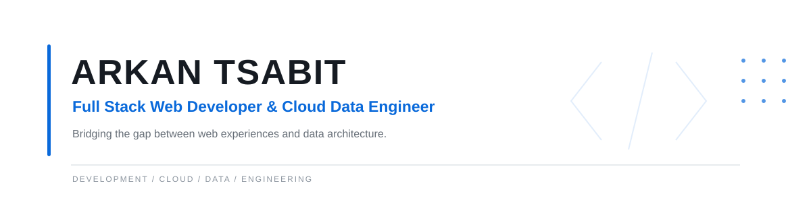

  <a href="https://katalogarkan.github.io">
    <picture>
      <source media="(prefers-color-scheme: dark)" srcset="assets/github-banner-dark.svg">
      <source media="(prefers-color-scheme: light)" srcset="assets/github-banner-light.svg">
      
    </picture>
  </a>

   
  
  
  

---

### Profile

I build for production. My work sits at the intersection of Full Stack Web Development and Cloud Data Engineering, specializing in translating complex data into high-performance, user-friendly applications. Every system I design is built to scale, automate, and deliver measurable results.

  
**Top 108 Globally** in the Oracle Race to Certification &bull; **10+ Certifications** from Oracle, IBM, and Meta.

---

### Technologies

**Front-End & Design**
 

  

**Data Engineering & Orchestration**
 

  

**Databases & Warehousing**
 

  

**Cloud & DevOps**
 

  

**Visualization**
 

---

### Featured Projects

<table align="center" width="100%" style="border-collapse: collapse;">
  <tr>
    <td width="50%" valign="top">
      <h4>GIG 1: Enterprise ETL Pipeline</h4>
      Production-ready, automated ETL pipeline designed for SaaS startups. Processes 1M+ rows of retail data for advanced analytics.  
      <code>Airflow</code> <code>Python</code> <code>PostgreSQL</code> <code>Streamlit</code>  
      <a href="https://katalogarkan.github.io/katalog/gig1-etl-pipeline">View Case Study &rarr;</a>
    </td>
    <td width="50%" valign="top">
      <h4>BatchETL Pipeline</h4>
      Automated ETL processing 2.96M+ NYC Taxi records with 100% data quality validation and real-time Grafana monitoring.  
      <code>Airflow</code> <code>Python</code> <code>DuckDB</code> <code>Docker</code>  
      <a href="https://katalogarkan.github.io/katalog/batchetl-pipeline">View Case Study &rarr;</a>
    </td>
  </tr>
  <tr>
    <td width="50%" valign="top">
       
      <h4>Uber Data Pipeline</h4>
      Star Schema Data Warehouse transforming raw Uber trip data into an optimized analytical model for interactive visualization.  
      <code>Airflow</code> <code>DuckDB</code> <code>Streamlit</code>  
      <a href="https://katalogarkan.github.io/katalog/uber-data-pipeline">View Case Study &rarr;</a>
    </td>
    <td width="50%" valign="top">
       
      <h4>Amazon Market Scraper</h4>
      Robust web scraper for competitive pricing and product data extraction, implementing data cleaning pipelines for actionable insights.  
      <code>Python</code> <code>BeautifulSoup</code> <code>Pandas</code>  
      <a href="https://katalogarkan.github.io/katalog/amazon-web-scraping">View Case Study &rarr;</a>
    </td>
  </tr>
  <tr>
    <td width="50%" valign="top">
       
      <h4>Full-Stack Expense Tracker</h4>
      Comprehensive personal finance application with CLI and GUI interfaces, featuring robust data validation and automated reporting.  
      <code>Python</code> <code>CLI</code> <code>GUI</code>  
      <a href="https://katalogarkan.github.io/katalog/daily-expense-tracker">View Case Study &rarr;</a>
    </td>
    <td width="50%" valign="top">
       
      <h4>katalogarkan (Portfolio)</h4>
      High-performance personal portfolio and freelance catalog featuring serverless forms, interactive React filters, and a custom design system.  
      <code>Astro</code> <code>React</code> <code>Tailwind</code>  
      <a href="https://katalogarkan.github.io">Live Demo &rarr;</a>
    </td>
  </tr>
</table>

---

### Technical Writing

I occasionally write about data engineering, cloud architecture, and software development.

- **[How I Ranked Top 108 Global in the Oracle Race to Certification](https://katalogarkan.github.io/blog/oracle-top108)**
  *A deep dive into my strategy, mindset, and technical preparation.*
- **[Building a Production-Ready ETL Pipeline with Airflow & BigQuery](https://katalogarkan.github.io/blog/batchetl-pipeline)**
  *How I designed and built an automated ETL pipeline processing 2.96M+ rows of data with 100% quality.*
- **[What Winning the Best Teacher Award Taught Me About Tech Communication](https://katalogarkan.github.io/blog/best-teacher-award)**
  *Why explaining technology simply is just as important as writing the code itself.*

---

### GitHub Analytics

  
  

 

  <i>Building systems that turn raw data into automated, production-ready applications.</i>

